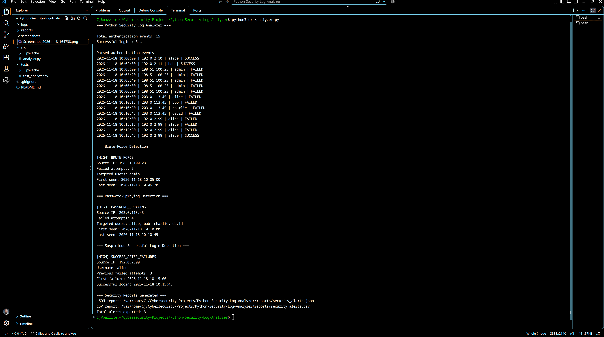
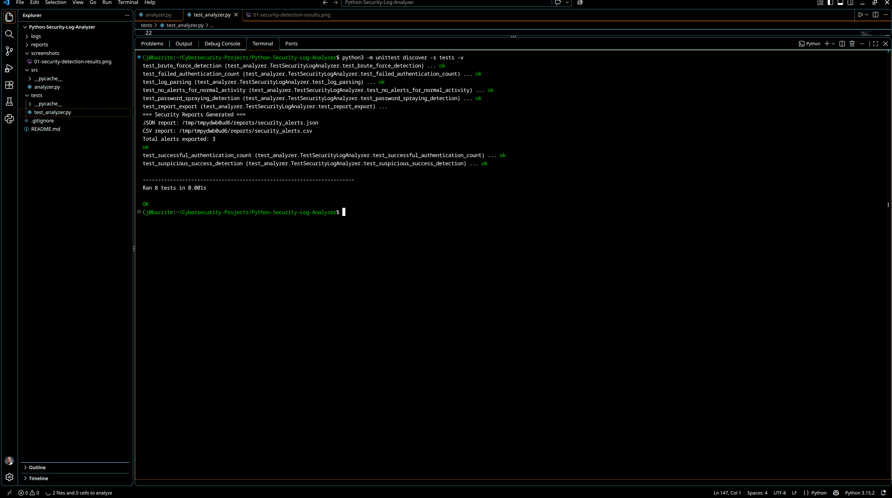
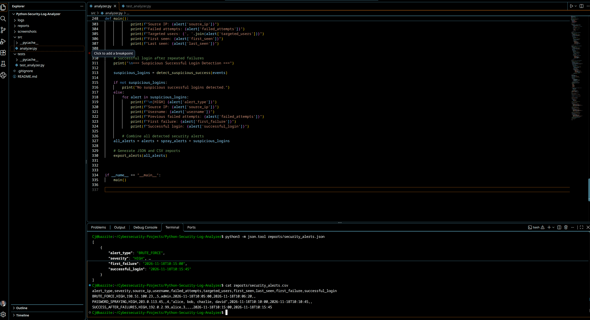

# Python Security Log Analyzer

A Python-based cybersecurity project that analyzes simulated Linux SSH authentication logs, detects suspicious login activity, and generates structured security alerts.

This project demonstrates security log analysis, Python automation, event correlation, and rule-based threat detection relevant to Security Operations Center (SOC) workflows.

## Project Overview

The Python Security Log Analyzer was developed to simulate the investigation and detection of suspicious SSH authentication activity.

The application parses authentication logs, extracts relevant security information, evaluates events against detection rules, and generates alerts for potentially malicious behavior.

### Key Features

- Automated parsing of SSH authentication logs
- Extraction of timestamps, usernames, source IP addresses, and authentication results
- SSH brute-force detection
- Password-spraying detection
- Detection of successful logins following repeated authentication failures
- Sliding-window analysis for time-based detection
- HIGH-severity security alert generation
- JSON and CSV security report exports
- Automated unit testing using Python's unittest framework

## Technologies Used

| Technology | Purpose |
|------------|---------|
| Python 3 | Security automation and log analysis |
| Regular Expressions | Parsing SSH authentication events |
| datetime | Timestamp processing and event correlation |
| collections | Grouping events and sliding-window detection |
| JSON | Structured security alert reporting |
| CSV | Tabular security alert reporting |
| unittest | Automated testing and validation |
| Linux | Development and execution environment |
| Git and GitHub | Version control and project documentation |

The project uses Python's standard library and does not require third-party packages.

## Detection Methodology

The analyzer evaluates SSH authentication events against three detection rules.

| Detection Rule | Detection Threshold | Severity |
|----------------|---------------------|----------|
| Brute Force | 5 failed authentication attempts from one IP within 2 minutes | HIGH |
| Password Spraying | Failed authentication attempts against 4 distinct usernames from one IP within 2 minutes | HIGH |
| Success After Failures | 3 failed attempts followed by a successful login for the same username and source IP within 5 minutes | HIGH |

### Rule 1: SSH Brute-Force Detection

The analyzer identifies repeated failed authentication attempts originating from the same source IP address.

A HIGH-severity alert is generated when five failed attempts occur within a two-minute window.

This pattern can indicate an attempt to gain unauthorized access through repeated authentication attempts.

### Rule 2: Password-Spraying Detection

The analyzer identifies failed authentication attempts against multiple usernames originating from a single source IP address.

A HIGH-severity alert is generated when four distinct usernames are targeted within a two-minute window.

This pattern is consistent with password spraying, although the authentication logs do not reveal whether the same password was used across accounts.

### Rule 3: Successful Login After Repeated Failures

The analyzer correlates failed authentication events with subsequent successful authentication.

A HIGH-severity alert is generated when three or more failed attempts are followed by a successful login involving the same username and source IP address within five minutes.

This behavior may warrant investigation for potential account compromise, although legitimate users can also generate similar authentication sequences.

## Investigation Results

The analyzer processed a synthetic SSH authentication dataset containing 15 events.

### Authentication Summary

| Metric | Result |
|--------|--------|
| Total authentication events | 15 |
| Successful authentication events | 3 |
| Failed authentication events | 12 |
| Detection rules executed | 3 |
| Security alerts generated | 3 |
| Alert severity | HIGH |

### Finding 1: Brute-Force Activity

**Alert Type:** BRUTE_FORCE

**Severity:** HIGH

**Source IP:** `198.51.100.23`

**Targeted Account:** `admin`

**Failed Attempts:** 5

**First Seen:** 2026-11-18 10:05:00

**Last Seen:** 2026-11-18 10:06:20

Five failed SSH authentication attempts targeted the `admin` account within 80 seconds.

The analyzer identified this activity as meeting the configured brute-force detection threshold.

**Assessment:** Suspicious repeated authentication failures consistent with a brute-force attempt.

### Finding 2: Password-Spraying Pattern

**Alert Type:** PASSWORD_SPRAYING

**Severity:** HIGH

**Source IP:** `203.0.113.45`

**Failed Attempts:** 4

**Targeted Accounts:** alice, bob, charlie, david

**First Seen:** 2026-11-18 10:10:00

**Last Seen:** 2026-11-18 10:10:45

Four failed authentication attempts targeted four distinct usernames within 45 seconds.

The analyzer identified this activity as meeting the configured password-spraying detection threshold.

**Assessment:** Suspicious authentication activity consistent with a password-spraying pattern.

### Finding 3: Suspicious Successful Authentication

**Alert Type:** SUCCESS_AFTER_FAILURES

**Severity:** HIGH

**Source IP:** `192.0.2.99`

**Targeted Account:** `alice`

**Previous Failed Attempts:** 3

**First Failure:** 2026-11-18 10:15:00

**Successful Login:** 2026-11-18 10:15:45

Three failed authentication attempts against the `alice` account were followed by a successful login from the same source IP address.

The analyzer correlated the authentication events and generated a HIGH-severity alert.

**Assessment:** Successful authentication following repeated failures warrants further investigation to determine whether the activity was legitimate.

These findings are based on synthetic authentication data and do not represent confirmed real-world attacks or account compromise.

## Evidence Screenshots

### 1. Security Detection Results

The analyzer successfully identified all three suspicious authentication patterns and generated corresponding HIGH-severity alerts.

The screenshot demonstrates:

- SSH brute-force detection
- Password-spraying detection
- Successful authentication following repeated failures
- JSON and CSV report generation



### 2. Automated Unit Testing

Eight automated unit tests passed successfully.

The tests validate authentication log parsing, event counts, detection rules, normal activity handling, and report generation.



### 3. JSON and CSV Security Reports

The analyzer exports detected security alerts into structured JSON and CSV files.

These reports can support further security analysis, documentation, and potential integration with other security workflows.



## Project Structure

```text
Python-Security-Log-Analyzer/
├── logs/
│   └── auth.log
├── src/
│   └── analyzer.py
├── tests/
│   └── test_analyzer.py
├── reports/
│   └── samples/
│       ├── security_alerts_sample.json
│       └── security_alerts_sample.csv
├── screenshots/
│   ├── 01-security-detection-results.png
│   ├── 02-unit-test-results.png
│   └── 03-report-generation.png
├── README.md
└── .gitignore
```

Generated JSON and CSV reports are excluded from version control. The `reports/samples/` directory contains representative output for portfolio review.

## Installation and Usage

### Prerequisites

- Python 3
- Git
- Linux, macOS, or another environment capable of running Python

No external Python dependencies are required.

### 1. Clone the Repository

```bash
git clone https://github.com/cmitch30/Python-Security-Log-Analyzer.git
cd Python-Security-Log-Analyzer
```

### 2. Run the Analyzer

```bash
python3 src/analyzer.py
```

The analyzer will:

1. Read the synthetic SSH authentication log.
2. Parse authentication events.
3. Count successful and failed authentication attempts.
4. Execute the three detection rules.
5. Display detected security alerts.
6. Generate JSON and CSV security reports.

### 3. Review Generated Reports

After execution, the following files will be created:

```text
reports/security_alerts.json
reports/security_alerts.csv
```

Validate and display the JSON report:

```bash
python3 -m json.tool reports/security_alerts.json
```

Display the CSV report:

```bash
cat reports/security_alerts.csv
```

## Automated Testing

The project includes eight automated unit tests using Python's built-in unittest framework.

### Test Coverage

| Test | Purpose |
|------|---------|
| Log Parsing | Verifies that all 15 authentication events are parsed |
| Successful Authentication Count | Confirms three successful logins |
| Failed Authentication Count | Confirms 12 failed logins |
| Brute-Force Detection | Validates the brute-force detection rule |
| Password-Spraying Detection | Validates detection of multiple targeted accounts |
| Suspicious Successful Login | Validates correlation between failed and successful logins |
| Normal Activity | Confirms that the normal-login sample does not trigger alerts |
| Report Export | Verifies JSON and CSV report generation and alert contents |

### Run All Tests

```bash
python3 -m unittest discover -s tests -v
```

### Verified Test Results

```text
----------------------------------------------------------------------
Ran 8 tests

OK
```

All eight tests passed against the synthetic dataset.

## Security Alert Reports

The analyzer generates two report formats.

### JSON Report

The JSON report contains structured security alert records suitable for automated processing.

Example:

```json
{
    "alert_type": "BRUTE_FORCE",
    "severity": "HIGH",
    "source_ip": "198.51.100.23",
    "failed_attempts": 5,
    "targeted_users": "admin",
    "first_seen": "2026-11-18T10:05:00",
    "last_seen": "2026-11-18T10:06:20"
}
```

### CSV Report

The CSV report provides tabular security alert records that can be reviewed using spreadsheet applications or imported into other analysis tools.

### Sample Reports

- [View Sample JSON Security Alerts](reports/samples/security_alerts_sample.json)
- [View Sample CSV Security Alerts](reports/samples/security_alerts_sample.csv)

The sample reports contain only synthetic data and reserved documentation IP addresses.

## SOC Analyst Relevance

This project demonstrates technical skills relevant to entry-level SOC analyst and security automation roles.

### Security Monitoring

Analyzed authentication events to identify suspicious login patterns using configurable detection thresholds.

### Event Correlation

Correlated authentication failures and successful logins using source IP addresses, usernames, and timestamps.

### Threat Detection

Implemented rule-based detections for brute-force activity, password-spraying patterns, and suspicious successful authentication.

### Security Automation

Developed Python scripts to automate log parsing, security alert generation, and structured report exports.

### Detection Validation

Created automated unit tests to verify detection functionality and validate expected security alert outputs.

### Security Documentation

Documented investigation findings, detection methodology, evidence screenshots, and limitations in a GitHub-hosted cybersecurity project.

## Detection Limitations

This project is an educational proof of concept rather than a production-ready security monitoring system.

Current limitations include:

- The parser expects a specific ISO 8601 SSH authentication log format.
- The analyzer processes existing log files rather than monitoring events in real time.
- Detection thresholds are configurable through function parameters but not through a command-line interface.
- Password-spraying detection identifies attempts against multiple usernames but cannot determine whether identical passwords were used.
- Brute-force detection groups failures by source IP and does not independently establish malicious intent.
- The current alert logic does not fully support multiple independent attack episodes from the same IP address.
- The automated tests validate the included synthetic dataset but do not cover all possible edge cases.
- The tool does not perform automatic account blocking, IP blocking, or incident remediation.

Additional validation and hardening would be required before operational deployment.

## Future Improvements

Potential enhancements include:

- Support for additional Linux authentication log formats
- Command-line arguments for custom log paths and detection thresholds
- Real-time authentication log monitoring
- Improved alert deduplication and independent attack episode tracking
- Additional unit tests for time-window boundaries and malformed log entries
- Configurable alert severity levels
- Structured logging and improved error handling
- SIEM integration for centralized security monitoring
- Automated incident ticket creation
- Security dashboards and visualization

## Disclaimer

This project was developed for educational purposes and cybersecurity portfolio development.

All authentication records are synthetic. IP addresses belong to reserved documentation ranges and do not represent actual attack infrastructure.

Detection results indicate suspicious authentication patterns and should not be interpreted as confirmed security incidents without further investigation.

## Author

**Clark Mitchell**

B.S. Cybersecurity and Information Assurance — Western Governors University (Expected March 2027)

CompTIA Security+ | CompTIA Network+ | CompTIA A+ | ITIL

[GitHub Profile](https://github.com/cmitch30)

[LinkedIn Profile](https://www.linkedin.com/in/clarkjmitchell/)
